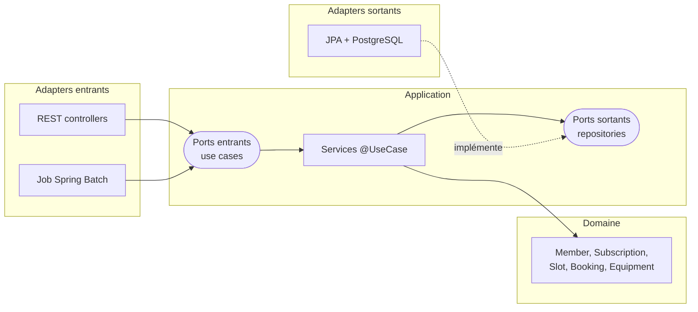

# climbing-gym-api


API de gestion d'une salle d'escalade : adhérents, abonnements, créneaux, réservations et location de matériel,
avec un import CSV des adhérents en Spring Batch et un petit front React.

## Stack

| | |
|---|---|
| Langage / framework | Java 21, Spring Boot 3.5 |
| Architecture | Hexagonale (ports & adapters), vérifiée par ArchUnit |
| Persistance | PostgreSQL 16, Spring Data JPA, migrations Liquibase |
| Batch | Spring Batch 5 (import CSV des adhérents) |
| Tests | JUnit 5, AssertJ, Testcontainers (PostgreSQL), MockMvc |
| Qualité | JaCoCo, SonarCloud |
| CI | GitHub Actions (backend + front) |
| Front | React 19, TypeScript, Vite |
| Doc API | OpenAPI / Swagger UI (springdoc) |

## Architecture



```
src/main/java/fr/climbinggym
├── domain/            # modèle métier, règles, exceptions — aucune dépendance framework
├── application/
│   ├── port/in/       # interfaces des use cases + commandes
│   ├── port/out/      # interfaces des repositories
│   └── service/       # implémentations des use cases (@UseCase)
├── adapter/
│   ├── in/web/        # controllers REST, DTO, gestion des erreurs
│   ├── in/batch/      # job d'import CSV
│   └── out/persistence/  # entités JPA, repositories Spring Data, mappers
└── config/            # câblage Spring, transactions, CORS, OpenAPI, données de démo
```

Quelques choix :

- **Le domaine et la couche application sont en Java pur.** Les services sont instanciés dans `UseCaseConfig`, et
  les transactions sont posées par un advisor AOP sur l'annotation maison `@UseCase` : pas de `@Transactional` ni
  de `@Service` dans le cœur métier. ArchUnit fait échouer le build si une dépendance Spring/JPA s'y glisse.
- **Entités JPA séparées des objets métier**, avec des mappers explicites dans l'adapter de persistance.
- **Pas de surbooking en concurrence** : la réservation verrouille la ligne du créneau (`SELECT … FOR UPDATE`) avant
  de compter les places. Un test d'intégration lance 8 réservations simultanées sur un créneau de 3 places.
- **Tests unitaires sur fakes en mémoire** plutôt que sur mocks : les ports sortants ont des implémentations
  `InMemory*Repository`, ce qui rend les tests de services lisibles et robustes aux refactos.
- **Le batch passe par les use cases** : les adhérents importés respectent exactement les mêmes règles que via l'API.

## Règles métier

- Abonnements : mensuel, annuel, ou carte de 10 entrées (valable 12 mois). Pas deux abonnements à durée qui se
  chevauchent.
- Réserver un créneau demande un abonnement valide le jour du créneau. Un abonnement à durée est utilisé en priorité,
  sinon une entrée de la carte est décomptée (et rendue en cas d'annulation).
- Créneaux `ROPE` (voie) réservés aux adhérents titulaires du passeport assurage, créneaux `KIDS` aux moins de 18 ans.
- Pas de réservation en double, ni sur un créneau complet ou déjà commencé ; annulation possible jusqu'au début.
- Matériel : impossible de louer plus que le stock disponible ou de rendre plus que ce qui est loué.

## Lancer en local

Prérequis : JDK 21, Docker, Node 22 (pour le front).

```bash
docker compose up -d                                  # PostgreSQL
./gradlew bootRun --args='--spring.profiles.active=dev'  # API + données de démo
```

- API : http://localhost:8080/api
- Swagger UI : http://localhost:8080/swagger-ui.html

Front :

```bash
cd frontend
npm install
npm run dev   # http://localhost:5173
```

Tout en Docker : `docker compose --profile full up --build`.

## Endpoints principaux

Toutes les réponses sont enveloppées dans `{ "data": … }`, les erreurs dans
`{ "error": { "code", "message", "fields" } }` (400 validation, 404 introuvable, 409 règle métier).

| Méthode | URL | Description |
|---|---|---|
| GET | `/api/members?search=` | Recherche d'adhérents |
| POST | `/api/members` | Inscription |
| PATCH | `/api/members/{id}` | Mise à jour partielle |
| GET / POST | `/api/members/{id}/subscriptions` | Abonnements d'un adhérent / souscription |
| POST | `/api/subscriptions/{id}/cancel` | Résiliation |
| GET | `/api/slots?from=2026-11-02&to=2026-11-08` | Créneaux avec places restantes |
| POST | `/api/slots` | Planifier un créneau |
| POST | `/api/slots/{id}/bookings` | Réserver (`{ "memberId": … }`) |
| POST | `/api/bookings/{id}/cancel` | Annuler une réservation |
| GET | `/api/members/{id}/bookings` | Réservations d'un adhérent |
| GET / POST | `/api/equipment` | Stock de matériel / ajout |
| POST | `/api/equipment/{id}/rentals` · `/returns` · `/restock` | Mouvements de stock (`{ "quantity": n }`) |
| POST | `/api/imports/members` | Import CSV (multipart, champ `file`) |

## Import CSV des adhérents

```
lastName;firstName;email;birthDate;belayCertified;subscriptionType
Durand;Léa;lea.durand@example.com;1994-03-12;oui;ANNUEL
Martin;Hugo;hugo.martin@example.com;22/07/1988;non;
```

- Séparateur `;`, en-tête obligatoire, dates `yyyy-MM-dd` ou `dd/MM/yyyy`.
- `belayCertified` : `oui`/`non`, `true`/`false`, `1`/`0`, `x`.
- `subscriptionType` (optionnel) : `MONTHLY`/`MENSUEL`, `ANNUAL`/`ANNUEL`, `TEN_ENTRIES`/`CARTE10`.
- Les lignes invalides sont ignorées et journalisées (skip), les emails déjà connus sont filtrés.
  La réponse donne le bilan : `read`, `written`, `filtered`, `skipped`.

```bash
curl -F file=@samples/members.csv http://localhost:8080/api/imports/members
```

## Tests

```bash
./gradlew test   # Docker doit tourner (Testcontainers)
```

- `domain/**` : tests unitaires des objets métier.
- `application/service/BookingServiceTest` : règles de réservation sur fakes en mémoire.
- `*IT` : tests d'intégration API + base réelle (PostgreSQL via Testcontainers), dont l'import CSV et la concurrence.
- `HexagonalArchitectureTest` : règles de dépendances ArchUnit.

Rapport de couverture : `build/reports/jacoco/test/html/index.html`.

## CI et SonarCloud

Le workflow `.github/workflows/ci.yml` build et teste le backend, puis lint et build le front.
L'analyse SonarCloud s'active automatiquement quand le secret est présent :

1. Importer le dépôt sur [sonarcloud.io](https://sonarcloud.io) (désactiver l'« Automatic Analysis »).
2. Dans GitHub → Settings → Secrets and variables → Actions :
   - secret `SONAR_TOKEN`
   - variables `SONAR_ORGANIZATION` et `SONAR_PROJECT_KEY`
